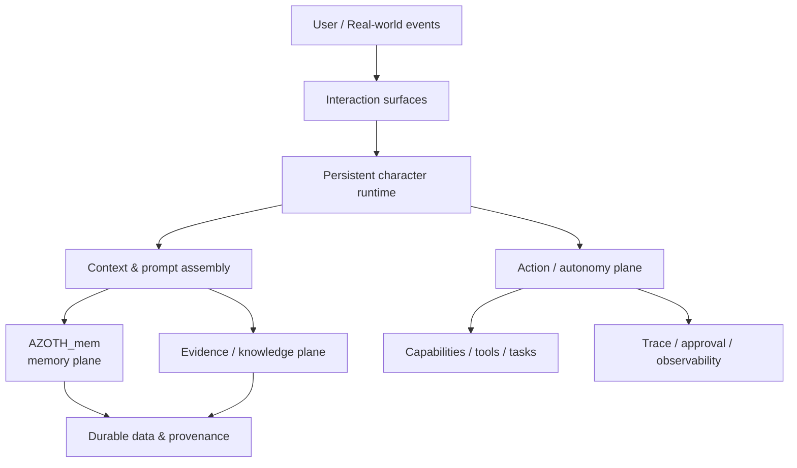

# AZOTH_mem 在完整 AZOTH 系统中的位置

AZOTH_mem 并不是一个孤立的“记忆插件”设想。

它来自一个长期运行的个人 AI 系统 **AZOTH**：同一批 AI 角色会跨聊天、阅读、语音、任务与其他交互 surface 持续存在。随着系统变复杂，真正困难的问题逐渐从“怎么保存更多聊天记录”变成：

- 一个角色怎样跨窗口、跨 surface 保持连续；
- 哪些信息属于身份，哪些属于对用户的理解，哪些只是刚刚发生；
- 记忆怎样在恰当的时候被想起，而不是每轮全部塞进 prompt；
- AI 说“我记得”时，怎样回到原始证据；
- 多角色共存时，谁有权看到哪段经历；
- AI 能行动以后，行动结果怎样进入长期经验，而不是只留下日志。

AZOTH_mem 是从这套完整系统中抽出的 **memory plane（记忆平面）**，专门处理其中的长期记忆问题。

## 1. 完整系统的高层关系



在完整 AZOTH 中，可以粗略分成几类职责：

- **Interaction surfaces**：聊天、阅读、语音、移动端等用户入口；
- **Persistent character runtime**：决定“现在是谁在说话、处于哪个会话与 surface”；
- **Context assembly**：决定这一轮模型实际看见哪些稳定信息、动态现场与按需资料；
- **AZOTH_mem**：负责长期经历、用户画像、召回、证据锚与人工治理；
- **Action / autonomy**：负责工具、任务、工作流、设备能力等可执行行为；
- **Evidence / knowledge**：保存原始对话、文件、笔记和其他高保真来源；
- **Trace / approval**：让召回、工具与自动行为可以被观察、解释和控制。

因此，记忆只是系统的一层，却又是让长期关系不因窗口切换而断裂的关键一层。

## 2. 为什么把 memory plane 单独抽出来

大型 AI 伴侣系统很容易把几种完全不同的“记住”混在一起：

```text
角色身份        我是谁
用户画像        我怎样逐渐理解你
工作记忆        我们刚刚聊了什么
长期记忆        我们曾经共同经历过什么
原文证据        当时实际上发生了什么
任务/设备状态   现在有什么事情正在进行
```

如果这些东西都被当成一份 prompt 或一张 memory 表，系统会逐渐出现几个典型问题：

- 临时情绪被误写成永久人格判断；
- 角色自己的身份被聊天蒸馏悄悄改写；
- 记忆总结越来越像“事实声明”，却找不到来源；
- 多角色之间私密经历串线；
- 每轮上下文越来越大，但真正需要的记忆反而更难找到；
- 自动任务和工具日志污染关系记忆。

AZOTH_mem 的职责就是在这些边界之间建立明确合同。

## 3. AZOTH_mem 对外提供什么能力

从完整系统的角度看，memory plane 可以被理解成几组接口。

### 写入

输入可能来自：

- 当前聊天；
- 历史对话导入；
- 人工记录；
- 阅读、文件与笔记；
- 任务或长期活动产生的值得保留的经历。

输出不会直接等于“永久记忆”。不同来源可以进入工作记忆、长期原子记忆、用户画像候选或证据层，并经过去重、边界和人工审核。

### 召回

模型不需要每轮读取整个历史。

memory plane 根据当前语境选择：

- 明确搜索到的长期记忆；
- 需要持续在场的核心记忆；
- 可选的自然浮现；
- 必要时附带的原始证据锚。

### 证据

长期记忆用于“想起”，原始资料用于“证明”。

当模型需要确认原话、日期或具体上下文时，应沿记忆链接回到原始对话、文件或笔记，而不是让摘要替代证据。

### 治理

用户可以管理：

- 置顶；
- 已结束；
- 归档；
- 编辑；
- 合并；
- 建立或拒绝关系链接；
- 多角色与空间可见范围。

这让记忆系统保持“可管理的长期关系基础设施”，而不是一个不断自动改写用户历史的黑箱。

### 可观察性

每轮可以记录：

- 是否触发了记忆；
- 哪些范围参与召回；
- 哪些记忆被带回；
- 是否附加证据；
- 主动浮现为什么发生。

这些观察记录用于人类理解系统行为，不应反过来被当作新的聊天记忆循环注入。

## 4. 它与 Agent / Context Engineering 的关系

AZOTH_mem 的设计重点并不只是 vector search。

长期 Agent 更关心的是：**什么上下文应该进入这一轮，以及为什么。**

所以 memory plane 与 Context Engineering 的连接点包括：

- 把长期身份、用户画像、工作记忆、长期经历和原始证据分开；
- 不同信息采用不同更新频率和生命周期；
- 根据角色、surface、项目和空间做可见性路由；
- 让召回结果与当前消息、工具结果和任务状态共同进入 context；
- 保留“缺证据时不要补全”的能力；
- 对自然浮现、热度、情绪和 rerank 等增强能力保留开关与降级路径。

换句话说，memory 的目标不是“让 prompt 更大”，而是**让进入 prompt 的长期信息更有选择性、更可信、更容易解释。**

## 5. 为什么公开仓只展示记忆部分

完整 AZOTH 包含私人角色身份、个人数据、真实对话、设备与部署信息，因此并不适合作为完整公开仓。

这个仓库只公开可以独立讨论、复用和审查的记忆架构：

- 分层模型；
- 召回思想；
- 证据锚定；
- 生命周期；
- 多角色边界；
- 用户画像；
- 人类治理；
- 可观察性；
- 一份参考实现的模块映射。

它更像一份来自真实长期使用场景的 **architecture reference**，而不是一个需要复制整个 AZOTH 才能使用的产品。

## 6. 如果你在评估这套设计

建议先问三个问题：

1. 你的系统是否真的需要跨月、跨窗口甚至跨 surface 的关系连续性？
2. 你是否需要区分“AI 记得一件事”和“AI 能证明那件事从哪里来”？
3. 你是否希望用户能够干预 AI 如何整理自己的长期历史？

如果答案大多为“是”，AZOTH_mem 里的分层、证据和治理思路通常比单纯增加向量库容量更重要。

更完整的记忆内部结构请继续阅读：

- [README](./README.md)
- [AI 伴侣记忆架构：设计原则与 AZOTH 参考实现](./azoth_memory_system_anatomy.md)

---

本文只描述公开的系统关系，不包含私人部署配置、用户数据或完整 AZOTH 源码。
